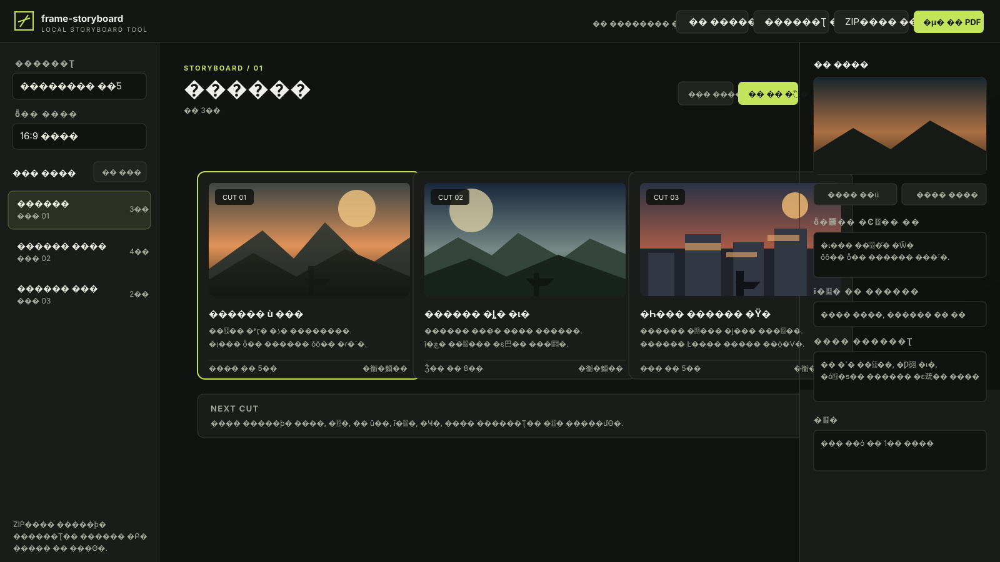

# frame-storyboard

PC에서 실행하는 단일 파일 뮤직비디오 스토리보드 도구입니다. 앱 파일 안에 HTML, CSS, JavaScript가 들어 있어 별도 설치나 서버 연결 없이 Chrome 또는 Edge에서 열어 사용할 수 있습니다.

## 사용 방법

1. [frame-storyboard.html](./frame-storyboard.html)을 내려받습니다.
2. 파일을 Chrome 또는 Edge에서 엽니다.
3. 프로젝트와 장면을 만들고, 각 컷에 사진과 연출 정보를 직접 넣습니다.
4. **ZIP으로 저장**을 눌러 프로젝트와 사진을 함께 백업합니다.
5. 다른 컴퓨터에서는 **프로젝트 열기**로 ZIP을 불러옵니다.

인쇄 · PDF 버튼으로 콘티를 출력하거나 PDF로 저장할 수 있습니다.

## 저장

편집 중인 프로젝트 정보는 현재 브라우저에 자동 저장되고, 사진은 로컬 브라우저 저장소에 보관됩니다. ZIP 내보내기에는 프로젝트 정보와 사진 파일이 포함됩니다. 장기 보관이나 다른 PC로 이동할 때는 ZIP 파일을 사용하세요.

이 도구는 사진이나 프로젝트를 서버로 전송하지 않으며 GPT/API 연결도 포함하지 않습니다.
